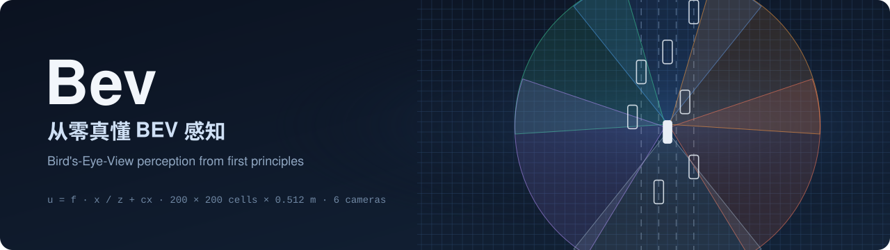
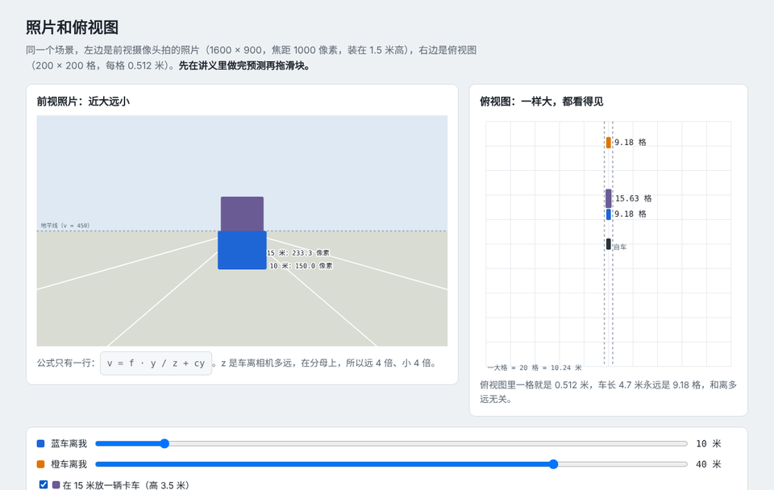
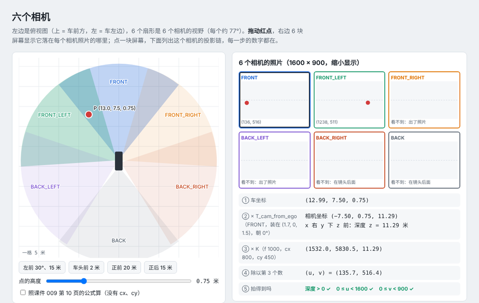
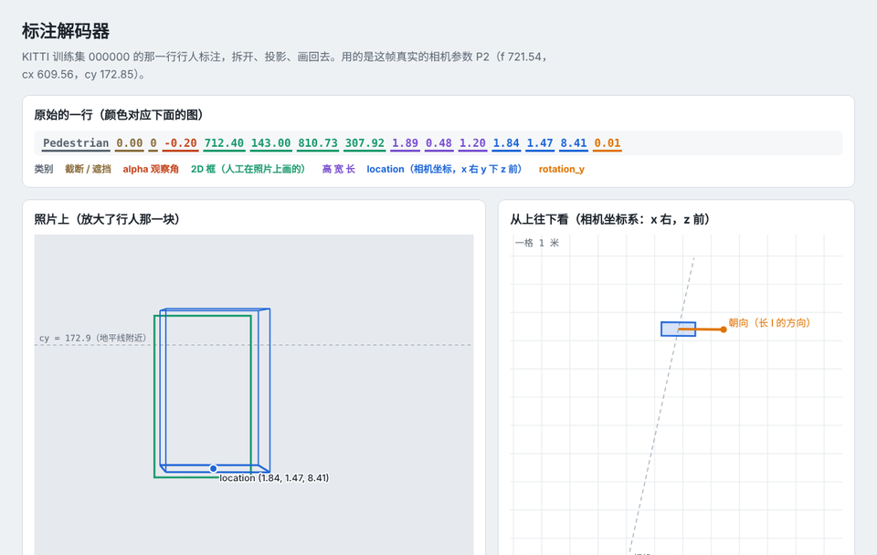
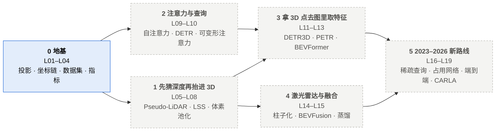

<div align="center">



<h3>19 课，把 BEV 感知从针孔相机一路讲到稀疏查询、占用网络和端到端</h3>

<p>每一课 = 图解讲义 + 交互动画 + 自己敲的核心代码 + 能手算的测试 + 可复现的实验</p>

[](https://www.python.org/)
[](https://numpy.org/)
[](https://pytorch.org/)
[](#快速开始)
[](#课程地图)
[](#课程地图)

[预览](#预览) · [特点](#特点) · [学习路线](#学习路线) · [快速开始](#快速开始) · [课程地图](#课程地图) · [课件对照表](#课件对照表)

</div>

---

BEV 课程的 PPT 每页只有几行要点：“LSS：先为每个像素生成所有可能深度的点”，一句话就过去了。这个仓库把每个要点拆成四件事：**一个能看见的现象、一行公式、一段自己写的代码、一个用手算数字核对的测试**。学完能从原理讲到代码，也能指出课件里的错误，比如 009 第 10 页的投影公式漏了光心 cx、cy。

## 预览

<table>
  <tr>
    <td width="33%" valign="top"><br><b>L01 · 照片和俯视图</b><br><sub>同一辆车，照片里远 4 倍小 4 倍，俯视图里一样大；卡车挡住的车在俯视图里还在。</sub></td>
    <td width="33%" valign="top"><br><b>L02 · 六个相机</b><br><sub>拖动一个点，看它落在哪个相机的哪个像素，外参、内参、除以深度每一步的数字都在。</sub></td>
    <td width="33%" valign="top"><br><b>L03 · 标注解码器</b><br><sub>KITTI 000000 的一行标注投回照片：location 是底面中心（IoU 0.73），不是正中心（0.32）。</sub></td>
  </tr>
</table>

<sub>动画都在 <code>docs/*.html</code>，下载后双击就能打开，不需要联网和安装。</sub>

## 特点

| 做到什么 | 怎么做到的 |
| --- | --- |
| **讲透，不罗列** | 每个公式逐个符号解释，配一组能手算的数字；课件里的错误直接标出来更正 |
| **自己写核心** | 每课 1–3 个核心函数自己敲；数据、训练循环、可视化、参考答案（`solutions/`）已写好 |
| **数字可核对** | 测试用手算值（例：u = 1000 × (−2) ÷ 10 + 800 = 600），真实数据用 KITTI 000000 的标注和标定核对 |
| **每课一个动画** | 拖动、切换条件，看每一步的中间结果 |
| **不漏一页** | 课件对照表：4 份 PPT 每一页在哪一课讲 |
| **跟上 2023–2026** | 课件之外补上稀疏查询（Sparse4D）、占用网络（FlashOcc、GaussianFormer）、BEV 到端到端（UniAD、SparseDrive、DiffusionDrive） |
| **接上工程** | 最后一课用 CARLA 采多相机数据训练迷你 BEV，放回 [highway-sim-eval](https://github.com/chasen2041maker/highway-sim-eval) 闭环，看感知误差怎么影响开车 |

## 学习路线



两条主线对应从照片到俯视图的两种思路：**2D → 3D**（先猜每个像素的深度，把特征“抬”进空间，LSS 一系）和 **3D → 2D**（拿 3D 里的点投到照片上去取特征，DETR3D、BEVFormer 一系）。

## 快速开始

```bash
git clone https://github.com/chasen2041maker/Bev.git
cd Bev
python -m pip install -r requirements.txt

python -m pytest tests/test_l01_geometry.py -v   # 一开始是失败的：核心函数等你来敲
python -m labs.l01_scale_and_occlusion          # 敲完、测试通过后跑实验
```

讲义从 [`docs/L01_perspective_vs_bev.md`](docs/L01_perspective_vs_bev.md) 开始。

## 一课怎么学

1. 读讲义开头的「这课回答什么问题」，打开动画。
2. **先预测**：讲义里有一道 ① ② 选择题，先写下答案再动手。
3. 在 `bev/` 里敲本课的核心函数（讲义里标了「你来敲」）。卡住先看文档字符串，再看 `solutions/`。
4. 跑测试：`python -m pytest tests/test_lxx_*.py -v`
5. 跑实验：`python -m labs.lxx_*`，对照你的预测。
6. 用一句话写结论，答完讲义末尾的面试题。

## 课程地图

★ = 面试高频，优先学透。「课件」列指自动驾驶之心 BEV 课程的 PDF 文件和页码。

| 状态 | 课 |
| --- | --- |
| ✅ 讲义、动画、代码、测试、实验都已就绪 | L01 · L02 · L03 |
| 编写中（始终领先学习进度 2–3 课） | L04 起 |

### 第 0 部分：地基（课件第 1 章 + 第 2 章开头）

| 课 | 回答的问题 | 你手敲的核心 | 课件 |
| --- | --- | --- | --- |
| L01 ★ | 为什么要从照片换成俯视图？ | 针孔投影 `project_to_image`、俯视图格子 `ego_to_bev_pixel` | 001 第 5、33、36 页 |
| L02 ★ | 一个 3D 点怎么落到某个相机的某个像素上？ | 内参 K、外参 T、齐次坐标、坐标系链（像素 ↔ 相机 ↔ 车 ↔ 世界） | 001 第 8、16、20 页，009 第 10 页 |
| L03 | KITTI / nuScenes 的标注和标定怎么读？ | 解析 KITTI 标注行、nuScenes「传感器 → 车 → 世界」变换链 | 001 第 13–22 页 |
| L04 ★ | 检测得好不好怎么打分？ | IoU、nuScenes mAP（中心距离阈值）、mATE / mASE / mAOE、NDS | 013 第 14 页 |

### 第 1 部分：2D → 3D，先猜深度再「抬」进空间（LSS 一系）

| 课 | 回答的问题 | 你手敲的核心 | 课件 |
| --- | --- | --- | --- |
| L05 | 照片丢了深度，怎么找回来？ | 深度图反投影成点云（Pseudo-LiDAR） | 009 第 13 页 |
| L06 ★ | LSS 的 Lift 在干什么？ | 视锥网格、深度分布 × 特征（外积） | 009 第 11–12 页，019 BEVDet |
| L07 ★ | Splat：几十万个点怎么快速落进俯视格子？ | 体素池化（scatter_add / 累加和技巧） | 019 BEVDepth（高效体素池化） |
| L08 | 训练一个迷你 LSS，深度监督有多大用？ | 损失与训练小步（训练循环助手写） | 019 BEVDet、BEVDepth |

### 第 2 部分：注意力与查询（课件第 2 章第 3 节 + Transformer 课第 3 节）

| 课 | 回答的问题 | 你手敲的核心 | 课件 |
| --- | --- | --- | --- |
| L09 | 注意力有哪几种，各在挑什么？ | SE 通道注意力、缩放点积注意力、多头 | 009 第 23–28 页 |
| L10 ★ | DETR 怎么不用 NMS 直接出框？可变形注意力省在哪？ | 匈牙利匹配的代价矩阵、单尺度可变形注意力采样 | Transformer 课第 3 节，009 第 29 页 |

### 第 3 部分：3D → 2D，拿 3D 点去图里「问」（查询一系）

| 课 | 回答的问题 | 你手敲的核心 | 课件 |
| --- | --- | --- | --- |
| L11 ★ | DETR3D：3D 参考点怎么从 6 个相机里取特征？ | 参考点投影 + 多相机采样 + 有效性掩码 | 009 第 17–18、30 页，019 DETR3D |
| L12 | PETR：不投影，把 3D 位置「写进」图像特征行不行？ | 视锥点 → 3D 坐标 → 位置编码；StreamPETR 的查询传播 | 009 第 19–20 页，019 PETR、PETRv2 |
| L13 ★ | BEVFormer：俯视格子怎么问图、怎么用上一帧？ | 柱子上多高度参考点、命中相机掩码、按自车运动对齐上一帧俯视图 | 019 BEVFormer，BEVDet4D |

### 第 4 部分：激光雷达与融合（课件第 3 章）

| 课 | 回答的问题 | 你手敲的核心 | 课件 |
| --- | --- | --- | --- |
| L14 | 点云怎么变成俯视图？ | 体素化 / 柱子化（PointPillars 式） | 001 第 10–11、24–25 页，009 第 6–7 页 |
| L15 | 相机和激光雷达怎么合？激光雷达能不能当老师？ | BEVFusion 融合模块、BEV-SAN 高度切片、BEVDistill 蒸馏损失 | 013 第 8、20–35、50 页，019 BEVDistill |

### 第 5 部分：2023–2026 的新路线（课件里没有，助手补）

| 课 | 回答的问题 | 你手敲的核心 |
| --- | --- | --- |
| L16 ★ | 稀疏查询（Sparse4D、SparseBEV、StreamPETR）为什么不建整张俯视图？ | 实例查询 + 关键点采样、跨帧传播 |
| L17 ★ | 占用网络：为什么从「框」走到「格子」？ | FlashOcc 的通道变高度、占用 mIoU；3D 高斯表示（GaussianFormer）的思路 |
| L18 ★ | 从 BEV 到端到端：UniAD、VAD、SparseDrive、DiffusionDrive 把感知接到规划的哪里？ | 追踪一个开源端到端模型的张量形状（不训练）；面试一页纸 |
| L19 | 综合实战（家里 4080）：CARLA 采多相机数据 → 训练迷你 BEV → 放回 highway-sim-eval 闭环，替换真值 | 数据采集、训练、闭环评测（和主线 A8 合流） |

## 项目结构

```text
Bev/
├── docs/          每课讲义（Lxx_*.md）和动画（*.html，双击打开）
│   └── images/    README 用的图
├── bev/           核心代码：你手敲的函数在这里
│   ├── geometry.py    L01 针孔投影、俯视图格子
│   ├── camera.py      L02 齐次变换、投影、反投影
│   ├── datasets.py    L03 KITTI 标注、3D 框角点、nuScenes 坐标链
│   ├── rig.py         6 相机支架（已写好）
│   └── pose.py        四元数和位姿（已写好）
├── labs/          每课实验脚本
├── tests/         测试（数字来自手算或真实数据）
├── data/          样例数据（KITTI 000000 的标注和标定、nuScenes 字段格式样例）
└── solutions/     参考答案
```

## 环境

| 设备 | 用途 | 需要 |
| --- | --- | --- |
| 任意电脑（只用 CPU） | L01–L05 | `numpy`、`matplotlib`、`pytest` |
| 同上 | L06 起 | 再加 CPU 版 PyTorch：`pip install torch --index-url https://download.pytorch.org/whl/cpu` |
| 有 NVIDIA 显卡（作者用 RTX 4080 Laptop 12 GB） | L08 训练、L19 CARLA 采数据和训练 | CUDA 版 PyTorch、CARLA 0.9.16 |

大模型（BEVFormer 全量等）只读结构、跑推理，不在本仓库里复现完整训练。

## 课件对照表

<details>
<summary>展开：4 份 PPT 加 Transformer 课用到的两讲，每一页在哪一课讲</summary>

<br>

页码是 PDF 的页码。“—”是封面、目录、二维码页。

### 001 BEV 感知算法介绍（39 页）

| 页 | 内容 | 在哪讲 |
| --- | --- | --- |
| 1–4 | 封面、目录 | — |
| 5–6 | BEV 是什么（尺度变化小、遮挡小）；BEV 感知是一组任务；输入有哪些 | L01 |
| 7–8 | 数据形式：图像（3D 的米 → 2D 的像素） | L01、L02 |
| 9–11 | 数据形式：点云（稀疏、无序；按点 / 按体素处理） | L14（L01 提一句） |
| 12–18 | KITTI：采集车、规模、传感器位置和转换矩阵、标注文件 | L03 |
| 19–22 | nuScenes：规模、传感器布置、文件夹、13 张表 | L03 |
| 23–25 | 激光雷达 BEV：先提特征再转 BEV（PV-RCNN）/ 先转 BEV 再提特征（PointPillars） | L14 |
| 26–27 | 相机 BEV 的通用结构（2D 特征 → 视角转换 → 3D 检测头）；BEVFormer 主体 | L06、L13 |
| 28–29 | 融合 BEV（BEVFusion 主体） | L15 |
| 30–33 | BEV 的优劣：对学术和工业的意义（成本：激光雷达约是视觉的 10 倍）、和点云方案的差距 | L01、L18 |
| 34–36 | 应用（Tesla、地平线、毫末） | L01、L18 |
| 37–39 | 课程框架 | 本 README |

### 009 BEV 感知算法基础模块讲解（31 页）

| 页 | 内容 | 在哪讲 |
| --- | --- | --- |
| 1–4 | 封面、目录 | — |
| 5 | 2D 图像处理：卷积、池化、残差、归一化、多视角输入 | L06（只讲用到的） |
| 6–7 | 3D 特征：按点处理、按体素处理 | L14 |
| 8–10 | 2D → 3D 的动机；针孔投影公式（**第 10 页缺 cx、cy，“世界坐标”应为相机坐标**） | L02 |
| 11–12 | LSS：给每个像素生成所有可能深度的点，再给每个点生成特征 | L06、L07 |
| 13 | Pseudo-LiDAR：先预测深度图，再反投影成点云 | L05 |
| 14–16 | 3D → 2D 的动机：拿 3D 的点去图里查特征 | L11 |
| 17–18 | 显式映射（DETR3D 式：3D 参考点投影到图像取特征，稀疏表示） | L11 |
| 19–20 | 隐式映射（PETR 式：把 3D 位置编码进图像特征） | L12 |
| 21–25 | 注意力：空间（STN）、通道（SENet）、混合（CBAM） | L09 |
| 26–28 | 自注意力、ViT、Swin Transformer | L09 |
| 29–30 | DETR、DETR3D | L10、L11 |

### 013 激光雷达和相机融合（59 页）

| 页 | 内容 | 在哪讲 |
| --- | --- | --- |
| 1–6 | 融合背景 | L15 |
| 7–11 | 融合思路：前融合（数据级）、深度融合（特征级）、后融合（目标级）、非对称融合 | L15 |
| 12–14 | 评价指标：mAP（中心距离）、mATE、mASE、mAOE、mAVE、mAAE、NDS | L04 |
| 16–35 | BEV-SAN：高度切片注意力、激光雷达引导的切片、多级融合、损失、性能和局限 | L15 |
| 37–58 | BEVFusion：相机流、激光雷达流、融合模块、损失、性能 | L15 |

### 019 基于环视相机的 BEV 感知（157 页）

| 页 | 内容 | 在哪讲 |
| --- | --- | --- |
| 1–8 | 为什么要环视相机、为什么要 BEV；主流算法总览 | L01、L02 |
| 9–14 | 各算法主体结构一览（DETR3D、BEVFormer、BEVDet、PETR、BEVDepth、BEVDistill） | 各自那一课 |
| 16–36 | DETR3D：参考点 → 投影到各相机 → 采样特征 → 更新查询；损失；性能 | L11 |
| 38–57 | BEVFormer：BEV 查询、空间交叉注意力、时序自注意力、可变形注意力；损失；性能 | L13 |
| 59–75 | BEVDet：图像编码、视角转换（深度分布）、BEV 编码、BEV 空间数据增强、Scale-NMS | L06–L08 |
| 77–91 | BEVDet4D：两帧 BEV 按自车运动对齐后融合 | L13 |
| 93–114 | PETR、PETRv2：3D 坐标生成、3D 位置编码、解码 | L12 |
| 116–135 | BEVDepth：深度监督、相机参数感知的深度网络、高效体素池化 | L07、L08 |
| 137–156 | BEVDistill：激光雷达老师 → 相机学生，稠密特征蒸馏 + 稀疏实例蒸馏 | L15 |

### Transformer 分割检测课（只用相关几讲）

| 讲 | 内容 | 在哪讲 |
| --- | --- | --- |
| 第 3 节 | DETR、Deformable DETR、Conditional / DAB / Hybrid DETR、Mask2Former | L10（DETR、可变形注意力），其余 L10 提一句 |
| 第六讲 | 点云 Transformer、点云补全、占用网络 | L14、L17 |

</details>

## 参考

**课件**：自动驾驶之心《BEV 感知》课程（5 章）与《基于 Transformer 的分割检测》课程。本仓库是按课件提炼重写的学习项目，不包含原课件。

**数据**：[KITTI](https://www.cvlibs.net/datasets/kitti/)（Geiger et al., CVPR 2012，CC BY-NC-SA 3.0），`data/` 里只摘录了训练集 000000 / 000001 的几行标注和标定；[nuScenes](https://www.nuscenes.org/)（Caesar et al., CVPR 2020），`data/` 里是按它的字段格式手造的样例，不含原始数据。

**2023–2026 新路线的依据**（2026-10 调研）：

- 稀疏感知模型（DETR3D、PETR 系、Sparse4D、SparseBEV、SparseOcc、GaussianFormer）不建稠密俯视图，用一小组查询直接从多视角图像取特征：[SQS（2025）](https://arxiv.org/html/2509.16588)；[Sparse4D（TPAMI 2026）](https://www.computer.org/csdl/journal/tp/2026/09/11498453/2g3CJnXusH6)。
- 占用感知综述：[Information Fusion 2025](https://github.com/HuaiyuanXu/3D-Occupancy-Perception)；[FlashOcc](https://arxiv.org/pdf/2311.12058)；[GaussianFormer-2](https://arxiv.org/pdf/2412.04384)。
- 稀疏端到端：[SparseDrive](https://arxiv.org/html/2405.19620v2)。BEV 综述（单模态 → 多模态 → 车路协同）：[2508.07560](https://arxiv.org/pdf/2508.07560)。
- 行业：头部车企以端到端为骨架，世界模型多在云端当仿真器（[虎嗅 2026-08-03](https://www.huxiu.com/article/4880232.html)）；量产模型缺少可比的闭环评测（[新出行 2026-08](https://www.xchuxing.com/article/174662)）。BEV / 占用 / 查询仍是这些模型内部的表示，也是面试必问的地基。

## 和主线的关系

主线是 [highway-sim-eval](https://github.com/chasen2041maker/highway-sim-eval)（基于 CARLA 的仿真评测与数据闭环）。本仓库穿插着学，一次只学一样；L19 把两条线接起来：用这里训练的 BEV 感知替换仿真里的真值，再用评测平台量感知误差对驾驶的影响。
